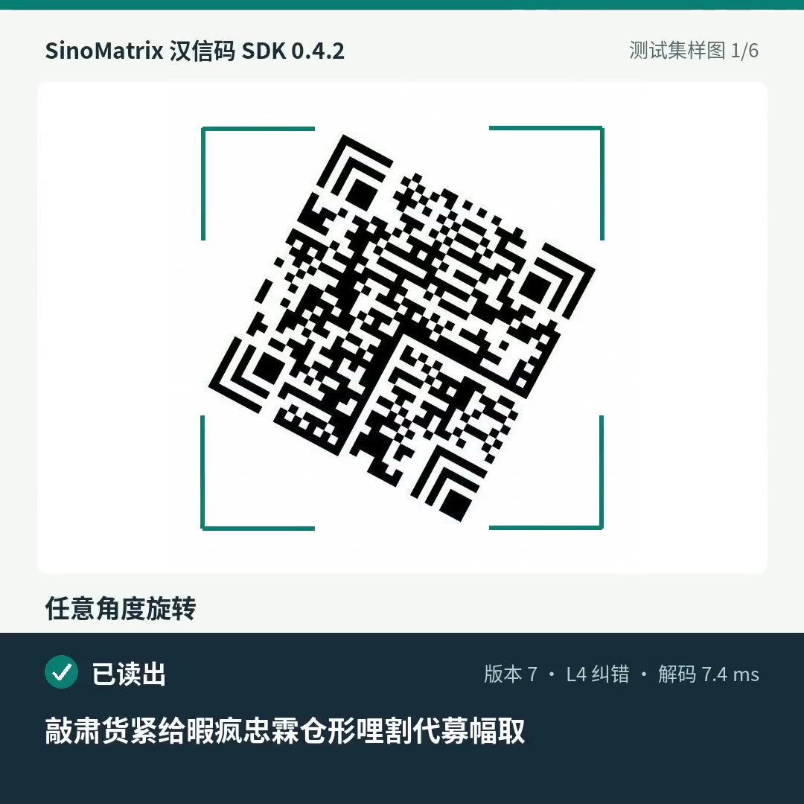
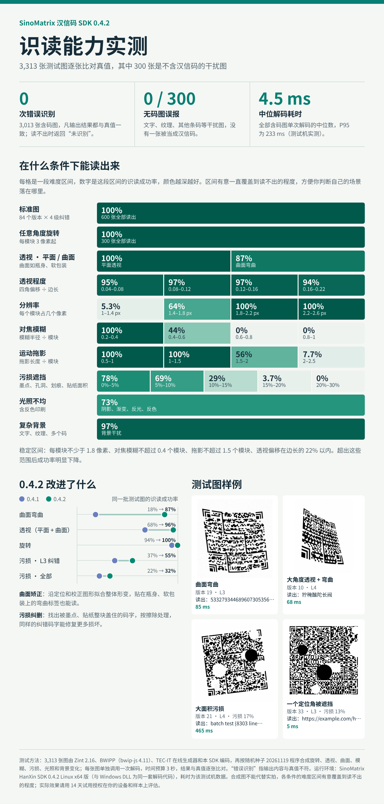

# SinoMatrix 汉信码 SDK 示例

汉信码（Han Xin Code，GB/T 21049 / ISO/IEC 20830）的**识别与生成**示例：C、C#、Python，Windows x64、Linux x64、Linux ARM64。

本仓库只放调用示例和测试图，不含 SDK 核心源码。SDK 运行库在 [Releases](../../releases/latest) 下载，使用前需要按设备签发的授权文件，可以先申请 **14 天免费试用**。

- 官网：https://hanxin-sdk.pages.dev/
- NuGet：[SinoMatrix.HanXin](https://www.nuget.org/packages/SinoMatrix.HanXin)
- 购买：[淘宝店铺](https://item.taobao.com/item.htm?id=1094008438046)



## 测试数据

3,313 张测试图逐张比对真值：

| 项目 | 结果 |
| --- | --- |
| 误读（输出内容与真值不符） | 0 次 / 3,013 张含码图 |
| 无码图误报 | 0 / 300 |
| 曲面弯曲识读率 | 87%（0.4.1 为 18%） |
| 中位解码耗时 | 4.5 ms（Linux x64 测试机） |

测试图由 Zint、BWIPP（bwip-js）、TEC-IT 在线生成器和本 SDK 编码，再程序合成旋转、透视、曲面、模糊、污损、光照和背景变化。合成图不能代替实拍，各条件的成功率见下图，请用试用授权在自己的设备和样本上评估。



## 快速开始

### C# / .NET

```bash
dotnet add package SinoMatrix.HanXin
```

```csharp
using SinoMatrixSdk;

HanXin.LoadLicense("license.lic");                              // 启动时一次
string? text = HanXin.Decode(gray, width, height, stride, timeLimitMs: 2000);   // 读不出返回 null
byte[] img = HanXin.Encode("追溯码 SMHX-2026-000123", out int w, out int h);
```

完整示例（读 JPG/PNG、生成 PNG）：[examples/csharp/HanXinDemo](examples/csharp/HanXinDemo)。Windows 上项目平台必须是 x64。

### Python

```python
from sinomatrix import SinoMatrix          # examples/python/sinomatrix.py，读图需要 pip install pillow

sdk = SinoMatrix()                          # 加载同目录的 SinoMatrix.dll / libSinoMatrix.so
sdk.load_license("license.lic")
print(sdk.decode_file("test-images/curved.jpg", time_limit_ms=2000))
```

还有批量识别、生成 PNG、OpenCV 画面识别：[examples/python](examples/python)。

### C（Linux x64 / ARM64，Windows 同样适用）

```bash
cmake -S examples/c -B build -DSINOMATRIX_ROOT=$HOME/SinoMatrix-SDK-0.4.2-Linux-arm64
cmake --build build
./build/decode_pgm license.lic photo.pgm
```

## 申请试用

1. 从 [Releases](../../releases/latest) 下载对应平台的 SDK 包。
2. 在运行程序的设备上执行设备申请程序：Windows `bin\SinoMatrixDeviceRequest.exe`，Linux `bin/sinomatrix-device-request`，得到 `device-request.req`。
3. 把申请文件发给我们，注明“试用”：
   - 淘宝旺旺：在[商品页](https://item.taobao.com/item.htm?id=1094008438046)点“联系卖家”
4. 收到该设备的 14 天 `license.lic` 后加载即可。购买后用同一份申请文件签发正式授权。

## 价格

| 授权 | 价格 |
| --- | --- |
| 开发版，1 台登记设备 | ¥399 |
| 运行时授权包，10 台 | ¥1,999 |
| 运行时授权包，100 台 | ¥9,800 |

以上为 Windows x64 价格（含 NuGet 包在 Windows 上使用），已购版本永久使用，90 天安装与缺陷支持。Linux 价格、OEM、源码买断请联系确认。下单在[淘宝](https://item.taobao.com/item.htm?id=1094008438046)完成。

## 测试图

`test-images/` 里是测试集中的几张样图（曲面、污损、光照不均、旋转），可以直接拿来跑示例。需要打印实物测试，可以向我们索取打印测试页 PDF。

## 许可

本仓库的示例代码以 MIT 许可发布，可以随意复制到你的项目里。SDK 运行库按授权协议使用，不在 MIT 许可范围内。
